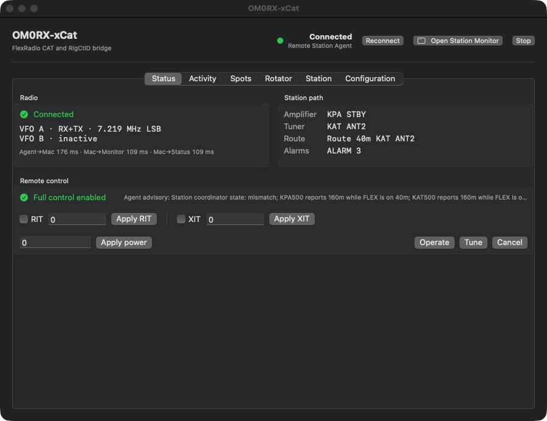

# OM0RX-xCat

[](https://github.com/oliverbross/OM0RX-xCat/releases/latest)
[](#requirements)
[](LICENSE)

OM0RX-xCat is a native macOS bridge between RUMlogNG (or another CAT client)
and a FlexRadio. It provides loopback-only Kenwood TS-480 CAT and Hamlib
RigCtlD TCP services, with native SmartLink remote access and no dependency on
the legacy xCAT application.

Copyright © 2026 Oliver Bross OM0RX. Licensed under GPL-3.0-only.



Current published release: [OM0RX-xCat 0.5.1](https://github.com/oliverbross/OM0RX-xCat/releases/tag/v0.5.1).

## Features

- Native Apple Silicon Swift/SwiftUI application for macOS 14 or later.
- Native SmartLink authentication, broker discovery, WAN TLS validation,
  Keychain refresh-token storage, and radio-certificate pinning.
- Separately configurable Remote Station Agent transport over authenticated
  HTTPS and WebSocket, with the bearer token stored in macOS Keychain.
- Menu-bar station widget with live VFO, KPA500, KAT500, route, commissioning,
  blocker, and alarm state.
- Compact menu-bar station monitor with live RX/TX state, exact frequency,
  dual VFOs, TX power, SWR, RF drive, detailed KPA/KAT telemetry, route
  alignment, station actions, reconnect, and configuration access.
- The same station monitor can be undocked into a normal movable window. Its
  screen position is restored on later launches.
- Built-in RUMlogNG UDP spot bridge with independent Logbook and Contest rule
  sets, priorities, colours, and marker lifetimes. Spots are sent through the
  authenticated Remote Station Agent and never key PTT or transmit RF.
- Mac-only DCU-1 rotator control over TCP, independent from the Windows Remote
  Station Agent. It imports an existing Rotor configuration, polls live azimuth,
  supports target/clockwise/counter-clockwise/stop commands, RUMlog UDP targets,
  Maidenhead and callsign-grid bearing calculation, per-band offsets, and
  bidirectional antennas.
- A dedicated Rotator settings tab and a wider station monitor with a live
  compass, beam-width sector, current and target bearings, world map, great-circle
  target line, movement state, and direct controls.
- Strict radio-serial and SmartSDR station selection.
- Live two-line VFO display. A and B each show their frequency, mode, and
  independent `RX` and `TX` roles from the radio's slice flags.
- RUMlogNG TS-480 compatibility: `FA`, `FB`, `KS`, `AI`, `IF`, `FR`, `FT`,
  `MD`, `RT`, `XT`, `PC`, `RX`, opt-in `TX`, and bounded `KY` CW commands.
- Live split reporting: `FR`, `FT`, and `IF` reflect the radio's actual RX and
  TX VFO rather than a cached CAT default.
- RigCtlD compatibility: `f`, `m`, `F`, `M`, and opt-in `T`.
- Direct local-network SmartSDR TCP and a supervised legacy-xCAT fallback.
- Command acknowledgements and timeouts, exponential reconnect, heartbeats,
  stale-state rejection, and best-effort Tune/CW/PTT shutdown.
- CAT and RigCtlD listeners bind only to `127.0.0.1`.

## Install

Download `OM0RX-xCat-v0.5.1-macOS.zip` from the
[OM0RX-xCat 0.5.1 release](https://github.com/oliverbross/OM0RX-xCat/releases/tag/v0.5.1),
expand it, and move `OM0RX-xCat.app` to `/Applications`. The release is signed
with the Developer ID certificate for Oliver Bross. It is not Apple-notarized;
see the release notes for the first-launch instructions and SHA-256 checksum.

Version 0.5.1 includes Remote Station Agent support, the native
RUMlogNG-to-FLEX panadapter spot bridge, the independent Mac rotator subsystem,
and the wide radio-plus-rotator station monitor. See
[`docs/ROTATOR.md`](docs/ROTATOR.md).
Remote Agent transport health and radio-telemetry readiness are displayed
separately, so a stale radio advisory does not masquerade as a reconnecting
HTTPS/WebSocket session.
The main window is organized into compact **Status**, **Activity**, **Spots**,
**Station**, and **Configuration** tabs. Each tab fits within the window without a
page-level scrollbar, and connection health is always shown with both color
and text.
The main configuration window can be restored from the menu-bar panel or
station monitor even after it has been minimized.

## Windows Remote Station Agent

The downloadable OM0RX-xCat archive contains the **macOS application only**.
The Windows-side **OM0RX Remote Station Agent** source is maintained in this
repository under [`WindowsAgent/`](WindowsAgent/). A standalone Windows `.exe`
or MSI installer is not currently published, so deploy the Python agent from
source and use the supplied PowerShell scripts to create its configuration,
scheduled task, tray controller, station widget, and private Tailscale endpoint.

The Windows agent is the sole owner of the FLEX TCP connection and the
KPA500/KAT500 serial ports. xCat connects to that agent over authenticated
HTTPS and WebSocket and continues to provide the local CAT/RigCtlD endpoints
used by RUMlogNG:

```text
RUMlogNG -> OM0RX-xCat on macOS -> Tailscale HTTPS/WebSocket
                                      |
                                      v
                           Windows Remote Station Agent
                                      |
                                      +-- FLEX radio
                                      +-- KPA500
                                      +-- KAT500
```

### Deploy on Windows

Install Python 3.11 or newer, clone the Windows repository, and run the
following commands in PowerShell from its project directory:

```powershell
git clone https://github.com/oliverbross/OM0RX-xCat.git
cd OM0RX-xCat\WindowsAgent
.\scripts\setup_remote_agent.ps1
.\scripts\init_remote_agent.ps1 -Python .\.venv\Scripts\python.exe
.\.venv\Scripts\python.exe -m remote_station check
```

Review the generated station configuration carefully. In particular, confirm
the FLEX address and exact SmartSDR station name, serial/COM ports, antenna
routing, per-band amplifier eligibility, power limits, and commissioning
state. Validate receive-only operation interactively before installing startup:

```powershell
.\scripts\run_remote_agent.ps1 -Python .\.venv\Scripts\python.exe -LogLevel info
.\scripts\install_remote_agent_startup.ps1 -Python .\.venv\Scripts\python.exe
.\scripts\install_remote_agent_tray_startup.ps1 -Python .\.venv\Scripts\python.exe
```

The first installer creates the hidden **OM0RX Remote Station Agent** scheduled
task. The second installs the interactive tray controller and station widget;
they monitor and manage the same Python agent and are not additional radio
controllers.

In an Administrator PowerShell, publish the loopback service privately through
Tailscale:

```powershell
.\scripts\configure_tailscale_serve.ps1
```

Do not enable Tailscale Funnel or forward the agent port on a public router.
In xCat select **Remote Station Agent**, enter the HTTPS URL reported by
Tailscale Serve, paste the generated `server.control_token`, save, and start.
xCat stores the token in macOS Keychain and does not place it in the URL.

See the complete
[Windows deployment and commissioning guide](WindowsAgent/docs/REMOTE_STATION_AGENT.md)
and the
[xCat client protocol guide](docs/REMOTE_AGENT_CLIENT.md). Users without access
to the Windows source can use xCat's direct local-network SmartSDR, native
SmartLink, or Simulator mode instead.

## First use with native SmartLink

For the direct **SmartLink** connection mode (not the Windows Remote Station
Agent mode):

1. Select **SmartLink**.
2. Enter the SmartLink account email and password. The password is used only
   for the initial authentication exchange and is not saved.
3. Optionally enter the preferred FlexRadio serial. Once selected, the app
   saves that serial and will not silently connect to a different radio.
4. Enter the exact active SmartSDR station name, such as `Maestro`.
5. Enable **Full CAT and station control** when the Windows station is ready,
   then click **Save Settings** and **Start**.

Later launches use an account-scoped refresh token stored in macOS Keychain.
Use **Forget Saved Session** to sign out. The remote radio's self-signed TLS
certificate is pinned by radio serial on first use; use **Reset Radio
Certificate Pin** only after deliberately confirming a radio certificate
change.

## RUMlogNG setup

In RUMlogNG configure:

- Transceiver: Kenwood TS-480 compatible
- Connection: TCP
- Host: `127.0.0.1`
- Port: `15002` (the OM0RX-xCat default)

Keep **Follow TRX** enabled. The app's top-right status uses two stable lines:

```text
VFO A · RX · 18.147 MHz USB
VFO B · TX · 18.153 MHz USB
```

`RX+TX` means the same VFO is both active receive and transmit. `inactive`
means SmartSDR has not exposed that slice. Newly opened slices are treated as
live immediately even when SmartSDR's incremental event omits `in_use=1`.

The RigCtlD endpoint defaults to `127.0.0.1:14532`. The historical 5002/4532
ports may be used only after stopping any service that already owns them. The
app verifies listener readiness and reports a port collision as startup failure.

For panadapter spots, enable RUMlogNG **Settings → UDP → DX spot (N1MM)** with
host `127.0.0.1` and port `12062`. OM0RX-xCat listens only on loopback. The
Spots tab also reserves `12063` for the independent contest rule set. Priorities,
colours, and lifetimes are editable without installing SpotToSunFlex.

In Remote Station Agent mode, the **Station** tab loads and edits the Windows
agent's non-secret hardware and policy configuration: KPA/KAT ports, FLEX
station and antenna rules, tune limits, antenna names, commissioning, and the
full per-band PA/barefoot/digital drive and routing matrix. **Save to Windows**
validates and atomically stores the settings while preserving the bearer token
and server bind configuration. Restart the Windows agent to activate a saved
configuration.

## Other connection modes

- **Remote Station Agent** connects only to the independent Windows station
  agent. Enter its Tailscale Serve HTTPS URL and bearer token, save, and start.
  The token is stored in Keychain and never placed in the URL, logs, settings,
  or WebSocket query string. See
  [`docs/REMOTE_AGENT_CLIENT.md`](docs/REMOTE_AGENT_CLIENT.md).
- **Local network** connects directly to the radio's SmartSDR TCP port 4992.
- **Remote via supervised xCAT** retains compatibility with the old xCAT app,
  including restart supervision, but is no longer required for the tested
  native SmartLink path.
- **Simulator** supports safe protocol testing without a radio.

## Requirements

- macOS 14 or newer on Apple Silicon
- RUMlogNG for the CAT/spot workflows
- A FlexRadio reachable through local SmartSDR, native SmartLink, supervised
  legacy xCAT, or the OM0RX Remote Station Agent

## Safety and scope

Transmit and CW commands are disabled by default for both CAT and RigCtlD.
Unkey remains available even when transmit is disabled. Test PTT only under
operator supervision at low power or into a dummy load. This application does
not transport or supervise RF audio.

The tested SmartLink path uses the radio's advertised public or UPnP-forwarded
TLS/TCP endpoint. UDP NAT hole punching is not implemented, so radios reachable
only through hole punching are outside the verified scope.

In Remote Station Agent mode every frequency/mode route change, receive/transmit
VFO selection, split change, PTT/tune, XIT, CWX, and RF-power write goes only to
the agent. OM0RX-xCat does not also write to SmartLink. The Mac does not impose
a second commissioning or alarm latch: with full control enabled it forwards
the agent's advertised command surface, while retaining status and alarm text
as operator advisories. The Windows agent is responsible for hardware policy.

## Build and test

```sh
swift test
./scripts/package-app.sh
open dist/OM0RX-xCat.app
```

The packaging script requires a valid `Developer ID Application` certificate,
builds the release binary, enables hardened runtime, signs the app, and verifies
the signature.

## Verification performed for v0.5.1

- Unit tests for CAT, RigCtlD, split RX/TX reporting, SmartLink authentication
  request construction, broker parsing, and SmartSDR command responses.
- Remote Station Agent connection, live status telemetry, and loopback CAT and
  RigCtlD readback.
- Minimize and restore of the main configuration window from the station
  monitor.
- Developer ID signing and hardened-runtime verification.

Live RF transmit was intentionally not exercised during automated acceptance.
