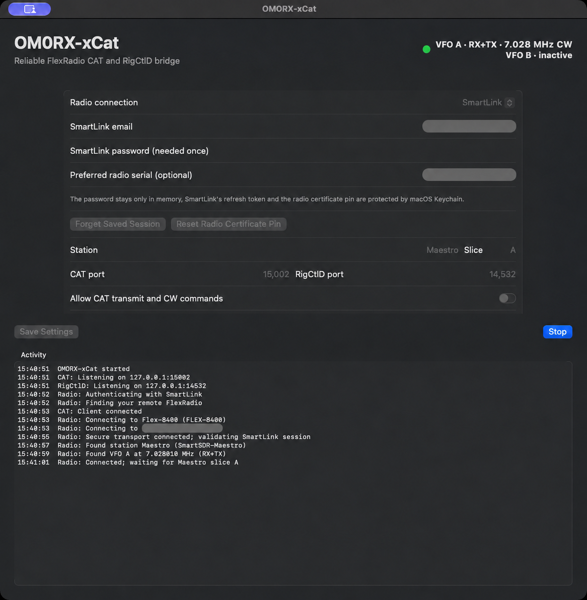

# OM0RX-xCat

OM0RX-xCat is a native macOS bridge between RUMlogNG (or another CAT client)
and a FlexRadio. It provides loopback-only Kenwood TS-480 CAT and Hamlib
RigCtlD TCP services, with native SmartLink remote access and no dependency on
the legacy xCAT application.

Copyright © 2026 Oliver Bross OM0RX. Licensed under GPL-3.0-only.



## Features

- Native Apple Silicon Swift/SwiftUI application for macOS 14 or later.
- Native SmartLink authentication, broker discovery, WAN TLS validation,
  Keychain refresh-token storage, and radio-certificate pinning.
- Strict radio-serial and SmartSDR station selection.
- Live two-line VFO display. A and B each show their frequency, mode, and
  independent `RX` and `TX` roles from the radio's slice flags.
- RUMlogNG TS-480 compatibility: `FA`, `FB`, `KS`, `AI`, `IF`, `FR`, `FT`,
  `MD`, `RX`, opt-in `TX`, and bounded `KY` CW commands.
- Live split reporting: `FR`, `FT`, and `IF` reflect the radio's actual RX and
  TX VFO rather than a cached CAT default.
- RigCtlD compatibility: `f`, `m`, `F`, `M`, and opt-in `T`.
- Direct local-network SmartSDR TCP and a supervised legacy-xCAT fallback.
- Command acknowledgements and timeouts, exponential reconnect, heartbeats,
  stale-state rejection, and best-effort Tune/CW/PTT shutdown.
- CAT and RigCtlD listeners bind only to `127.0.0.1`.

## Install

Download `OM0RX-xCat-v0.2.0.zip` from GitHub Releases, expand it, and move
`OM0RX-xCat.app` to `/Applications`. The release is signed with the Developer
ID certificate for Oliver Bross. See the release notes for notarization status.

On first use:

1. Select **SmartLink**.
2. Enter the SmartLink account email and password. The password is used only
   for the initial authentication exchange and is not saved.
3. Optionally enter the preferred FlexRadio serial. Once selected, the app
   saves that serial and will not silently connect to a different radio.
4. Enter the exact active SmartSDR station name, such as `Maestro`.
5. Leave **Allow CAT transmit and CW commands** off until receive operation is
   verified, then click **Save Settings** and **Start**.

Later launches use an account-scoped refresh token stored in macOS Keychain.
Use **Forget Saved Session** to sign out. The remote radio's self-signed TLS
certificate is pinned by radio serial on first use; use **Reset Radio
Certificate Pin** only after deliberately confirming a radio certificate
change.

## RUMlogNG setup

In RUMlogNG configure:

- Transceiver: Kenwood TS-480 compatible
- Connection: TCP
- Host: `127.0.0.1`
- Port: `15002` (the OM0RX-xCat default)

Keep **Follow TRX** enabled. The app's top-right status uses two stable lines:

```text
VFO A · RX · 18.147 MHz USB
VFO B · TX · 18.153 MHz USB
```

`RX+TX` means the same VFO is both active receive and transmit. `inactive`
means SmartSDR has not exposed that slice. Newly opened slices are treated as
live immediately even when SmartSDR's incremental event omits `in_use=1`.

The RigCtlD endpoint defaults to `127.0.0.1:14532`. The historical 5002/4532
ports may be used only after stopping any service that already owns them. The
app verifies listener readiness and reports a port collision as startup failure.

## Other connection modes

- **Local network** connects directly to the radio's SmartSDR TCP port 4992.
- **Remote via supervised xCAT** retains compatibility with the old xCAT app,
  including restart supervision, but is no longer required for the tested
  native SmartLink path.
- **Simulator** supports safe protocol testing without a radio.

## Safety and scope

Transmit and CW commands are disabled by default for both CAT and RigCtlD.
Unkey remains available even when transmit is disabled. Test PTT only under
operator supervision at low power or into a dummy load. This application does
not transport or supervise RF audio.

The tested SmartLink path uses the radio's advertised public or UPnP-forwarded
TLS/TCP endpoint. UDP NAT hole punching is not implemented, so radios reachable
only through hole punching are outside v0.2.0's verified scope.

## Build and test

```sh
swift test
./scripts/package-app.sh
open dist/OM0RX-xCat.app
```

The packaging script requires a valid `Developer ID Application` certificate,
builds the release binary, enables hardened runtime, signs the app, and verifies
the signature.

## Verification performed for v0.2.0

- Unit tests for CAT, RigCtlD, split RX/TX reporting, SmartLink authentication
  request construction, broker parsing, and SmartSDR command responses.
- Native SmartLink authentication and refresh-token relaunch.
- SmartLink broker discovery, WAN TLS validation, and exact-station binding on
  a FLEX-8400 running SmartSDR 4.2.20.
- Live frequency/mode state through OM0RX-xCat into RUMlogNG with legacy xCAT
  stopped.
- Developer ID signing and hardened-runtime verification.

Live RF transmit was intentionally not exercised during automated acceptance.
